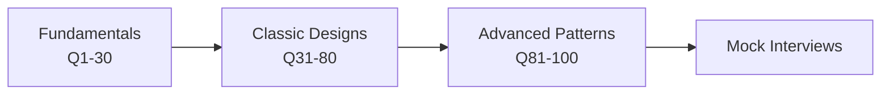

# 🏗️ System Design Interview Handbook

**100 essential system design questions — with concise answers and diagrams.**

[Start learning](#-roadmap) · [Question index](#-question-index) · [How to answer](docs/how-to-answer.md) · [Contribute](CONTRIBUTING.md)

---

## 📖 About

A practical, interview-focused guide to system design. Every question has a short answer, key trade-offs and a diagram so you can revise quickly.

- **Part A – Fundamentals:** scaling, caching, databases, queues, APIs
- **Part B – Classic designs:** URL shortener, chat, Uber, YouTube, payments…
- **Part C – Advanced patterns:** saga, CQRS, Raft, multi-region, observability

## 🗺️ Roadmap

| Week | Focus | Questions |
|:--:|:--|:--|
| 1 | Scaling, LB, caching, DB basics | 1–15 |
| 2 | Queues, APIs, reliability, estimation | 16–30 |
| 3–4 | Classic designs | 31–80 |
| 5 | Patterns, consensus, multi-region | 81–100 |
| 6 | Mock interviews + revision | All |

## 🎯 How to answer any question

1. Clarify requirements (functional / non-functional)
2. Estimate scale (QPS, storage, bandwidth)
3. Define API and data model
4. Draw high-level design
5. Deep-dive bottlenecks
6. Discuss trade-offs, failures, monitoring

More in [docs/how-to-answer.md](docs/how-to-answer.md).

## 📚 Question index

<!-- INDEX:START -->
_Run `python scripts/build.py` to generate the index._
<!-- INDEX:END -->

## 🤝 Contributing

PRs are welcome. See [CONTRIBUTING.md](CONTRIBUTING.md) and the [question template](docs/TEMPLATE.md).

## ⭐ Support

If this helps you, star the repo and share it with a friend preparing for interviews.

## 📄 License

[MIT](LICENSE)
