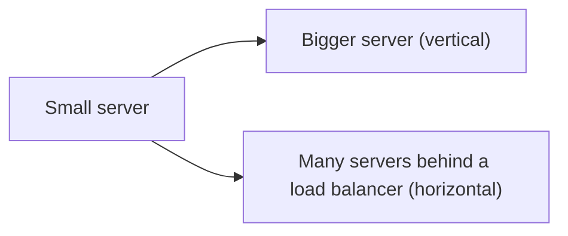

# 1. Vertical vs horizontal scaling?

> Part A: Fundamentals

**Answer:** Vertical = bigger machine (simple, limited, single point of failure). Horizontal = more machines (needs stateless services, load balancing, data partitioning; near-unlimited scale). Prefer horizontal for web tiers; scale DBs vertically first, then replicate and shard.

---
[⬆ Back to index](../../README.md#-question-index)
