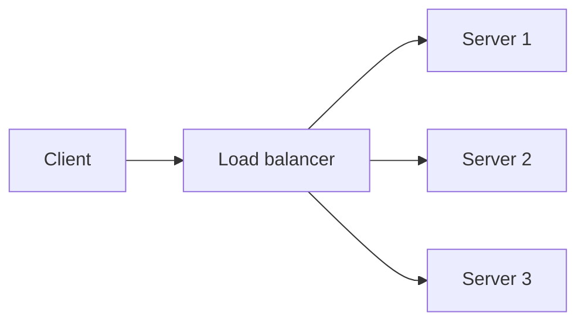

# 2. What is a load balancer and which algorithms exist?

> Part A: Fundamentals

**Answer:** Distributes traffic across servers for availability and throughput. L4 (TCP/IP, fast) vs L7 (HTTP aware, routing by path/header). Algorithms: round robin, weighted RR, least connections, IP hash, consistent hashing. Use health checks and run LBs in active-passive or active-active pairs.

---
[⬆ Back to index](../../README.md#-question-index)
