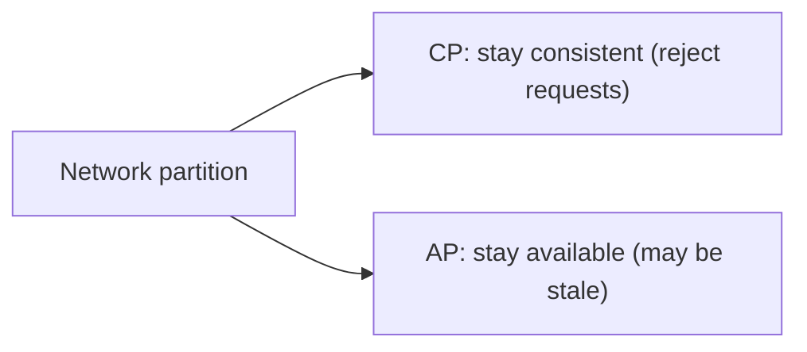

# 3. Explain the CAP theorem.

> Part A: Fundamentals

**Answer:** During a network partition you must choose Consistency or Availability. CP: reject/delay requests to stay consistent (HBase, etcd, MongoDB default). AP: serve possibly stale data (Cassandra, DynamoDB). Without partition, trade latency vs consistency (PACELC).

---
[⬆ Back to index](../../README.md#-question-index)
