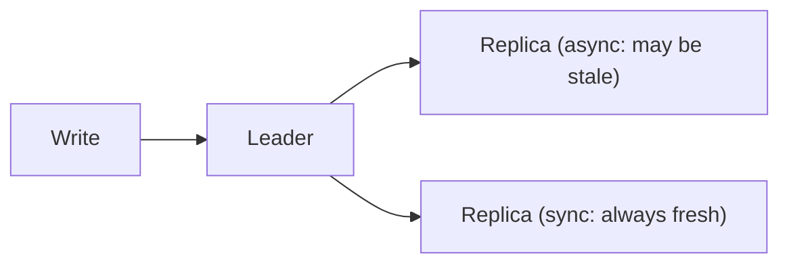

# 4. Strong vs eventual consistency?

> Part A: Fundamentals

**Answer:** Strong: every read sees the latest write (linearizable; higher latency). Eventual: replicas converge over time (low latency, high availability). Intermediate: read-your-writes, monotonic reads, causal consistency. Pick strong for payments/inventory, eventual for feeds/likes.

---
[⬆ Back to index](../../README.md#-question-index)
