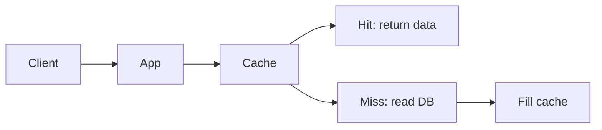

# 5. How does caching work and where do you place caches?

> Part A: Fundamentals

**Answer:** Store hot data in fast memory to cut latency and DB load. Layers: browser, CDN, API gateway, application (Redis/Memcached), DB buffer pool. Key concerns: eviction (LRU/LFU/TTL), invalidation, hit ratio, consistency.

---
[⬆ Back to index](../../README.md#-question-index)
