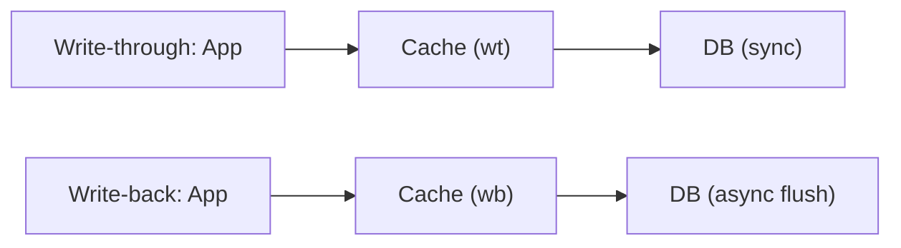

# 6. Cache write strategies?

> Part A: Fundamentals

**Answer:** Cache-aside (app loads on miss; most common). Read-through (cache loads). Write-through (write cache+DB synchronously; consistent, slower). Write-back (write cache, flush async; fast, risk of loss). Write-around (write DB only; avoids cache pollution).

---
[⬆ Back to index](../../README.md#-question-index)
