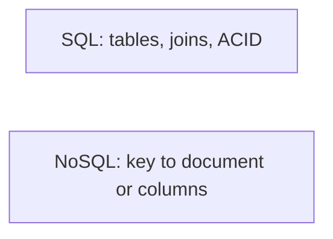

# 8. SQL vs NoSQL?

> Part A: Fundamentals

**Answer:** SQL: relational, ACID, joins, strong schema; good for transactions and complex queries. NoSQL: key-value, document, wide-column, graph; flexible schema, horizontal scale, tuned access patterns. Choose by access pattern, consistency and scale, and polyglot persistence is normal.

---
[⬆ Back to index](../../README.md#-question-index)
