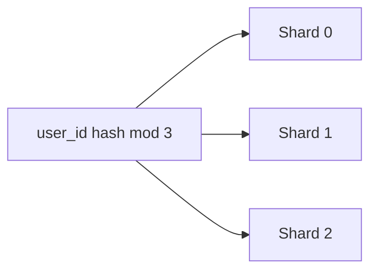

# 9. What is database sharding and how do you choose a shard key?

> Part A: Fundamentals

**Answer:** Splitting data across nodes. Strategies: range, hash, directory/lookup, geo. A good key has high cardinality, even distribution, and matches query patterns (avoids cross-shard queries). Challenges: hotspots, resharding, joins, transactions.

---
[⬆ Back to index](../../README.md#-question-index)
