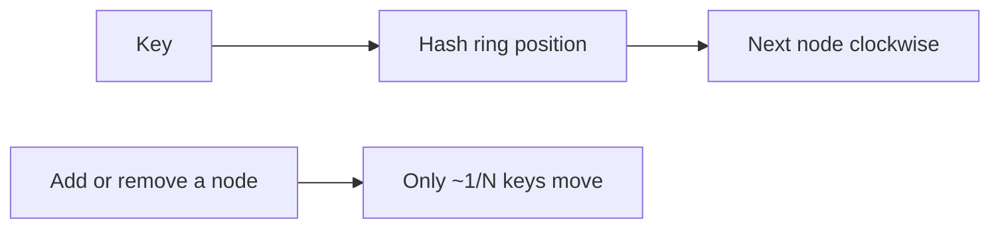

# 10. What is consistent hashing?

> Part A: Fundamentals

**Answer:** Nodes and keys are placed on a hash ring; a key belongs to the next node clockwise. Adding/removing a node remaps only ~1/N keys. Virtual nodes balance load and handle heterogeneous machines.

---
[⬆ Back to index](../../README.md#-question-index)
