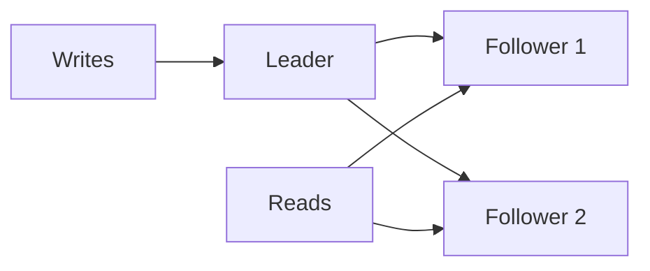

# 11. Database replication models?

> Part A: Fundamentals

**Answer:** Leader-follower (writes to leader, reads from followers; sync/async), multi-leader (multi-region writes, conflict resolution), leaderless (quorum, Dynamo style). Trade-offs: replication lag, failover, conflicts.

---
[⬆ Back to index](../../README.md#-question-index)
