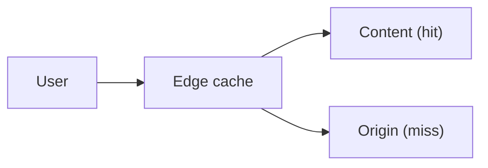

# 14. What is a CDN?

> Part A: Fundamentals

**Answer:** Geographically distributed edge caches serving static (and some dynamic) content near users. Pull CDN fetches from origin on miss; push CDN pre-uploads. Handle cache-control headers, invalidation/purge, signed URLs for private content.

---
[⬆ Back to index](../../README.md#-question-index)
