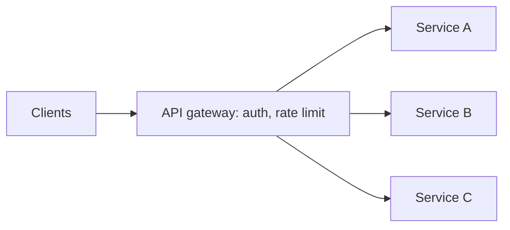

# 15. What is an API gateway?

> Part A: Fundamentals

**Answer:** Single entry point handling routing, auth, rate limiting, TLS termination, request aggregation, logging and versioning in front of microservices. Avoid making it a bottleneck: scale horizontally and keep business logic out.

---
[⬆ Back to index](../../README.md#-question-index)
