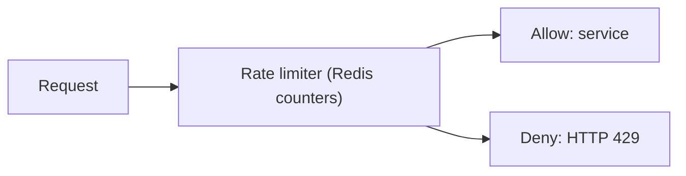

# 16. How do you design a rate limiter?

> Part A: Fundamentals

**Answer:** Algorithms: token bucket (bursts allowed), leaky bucket (smooth), fixed window (boundary burst issue), sliding window log/counter. Store counters in Redis with atomic Lua/INCR + TTL, keyed by user/IP/API key. Return 429 with Retry-After. Distributed: central Redis or local limit + sync.

> 📘 **Want more?** Read the [deep dive: Rate Limiter](../deep-dives/02-rate-limiter.md)

---
[⬆ Back to index](../../README.md#-question-index)
