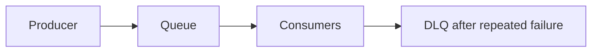

# 17. Message queues: why and when?

> Part A: Fundamentals

**Answer:** Decouple producers and consumers, absorb spikes, enable async processing and retries. Semantics: at-most-once, at-least-once (default; needs idempotent consumers), exactly-once (hard; transactions/dedup). Use DLQs for poison messages.

---
[⬆ Back to index](../../README.md#-question-index)
