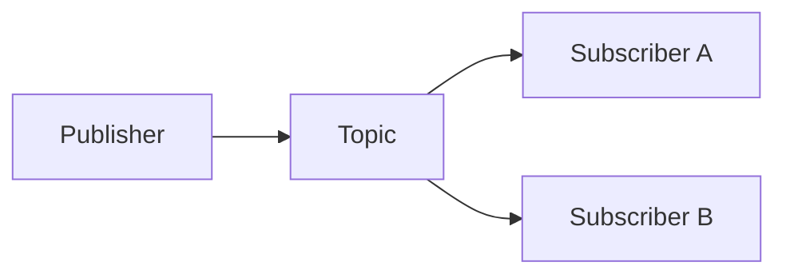

# 19. Pub/Sub vs point-to-point?

> Part A: Fundamentals

**Answer:** Point-to-point: each message consumed by one consumer. Pub/Sub: each subscriber gets a copy (fan-out). Combine: fan-out to multiple queues, each with competing consumers.

---
[⬆ Back to index](../../README.md#-question-index)
