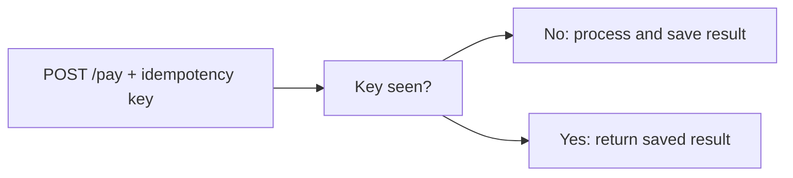

# 20. What is idempotency and how do you implement it?

> Part A: Fundamentals

**Answer:** Repeating a request yields the same effect. Client sends an idempotency key; server stores key->result (with TTL) and returns the stored result on retry. Essential for payments and at-least-once messaging. Use unique constraints or conditional writes.

---
[⬆ Back to index](../../README.md#-question-index)
