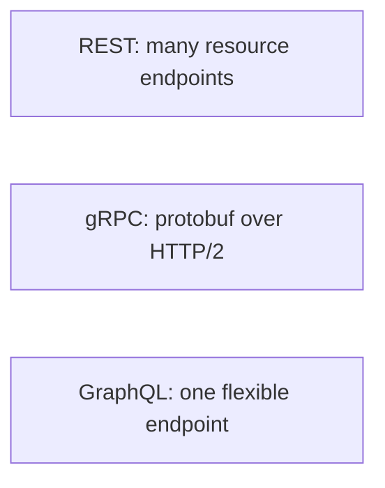

# 21. REST vs gRPC vs GraphQL?

> Part A: Fundamentals

**Answer:** REST: simple, cacheable, resource oriented. gRPC: HTTP/2, protobuf, streaming, low latency; good for internal service calls. GraphQL: client picks fields, avoids over/under-fetching; caching and N+1 complexity.

---
[⬆ Back to index](../../README.md#-question-index)
