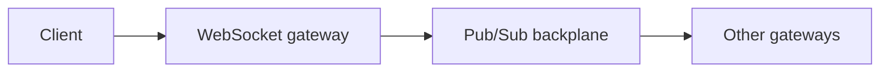

# 22. Polling vs long polling vs WebSockets vs SSE?

> Part A: Fundamentals

**Answer:** Polling: simple, wasteful. Long polling: server holds request until data. SSE: one-way server push over HTTP. WebSocket: full-duplex persistent connection (chat, games). Scale WebSockets with sticky routing and a pub/sub backplane.

---
[⬆ Back to index](../../README.md#-question-index)
