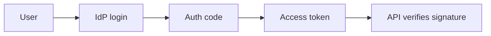

# 24. Authentication and authorization (OAuth2, JWT, sessions)?

> Part A: Fundamentals

**Answer:** Sessions: server-side state, easy revocation. JWT: signed stateless token; short expiry + refresh tokens; revocation is hard. OAuth2/OIDC: delegated access via authorization code flow (+PKCE). Authorization via RBAC/ABAC, enforced at gateway and service.

---
[⬆ Back to index](../../README.md#-question-index)
