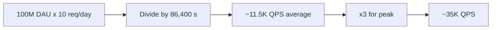

# 25. How do you estimate capacity (back-of-envelope)?

> Part A: Fundamentals

**Answer:** QPS = DAU x actions/day / 86400; peak ≈ 2-5x avg. Storage = items/day x size x retention x replication. Bandwidth = QPS x payload. Remember: 1 day ≈ 10^5 s, 1M req/day ≈ 12 QPS. Latency numbers: memory ~100ns, SSD ~100µs, same-DC RTT ~0.5ms, cross-continent ~150ms.

---
[⬆ Back to index](../../README.md#-question-index)
