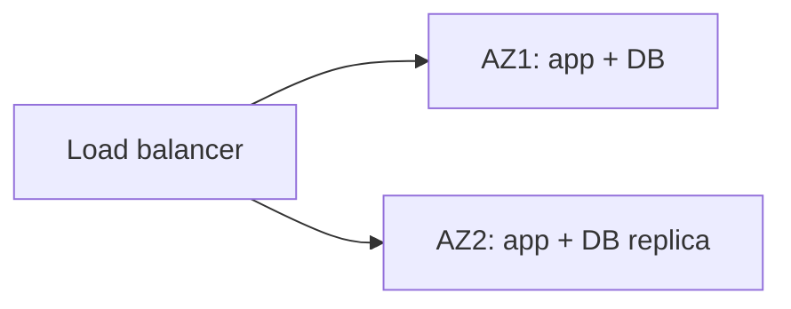

# 26. Availability and SLAs: how do you reach 99.99%?

> Part A: Fundamentals

**Answer:** 99.99% ≈ 52 min downtime/year. Remove single points of failure: redundancy across AZs/regions, health checks, auto-failover, graceful degradation, retries with backoff, circuit breakers, canary deploys, and chaos testing. Availability of serial components multiplies; parallel redundancy improves it.

---
[⬆ Back to index](../../README.md#-question-index)
