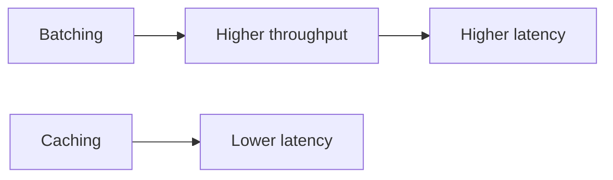

# 27. Latency vs throughput?

> Part A: Fundamentals

**Answer:** Latency = time per request (watch p50/p95/p99); throughput = requests/sec. Improve latency via caching, locality, async, fewer hops; throughput via parallelism, batching, queues. Batching raises throughput but adds latency.

---
[⬆ Back to index](../../README.md#-question-index)
