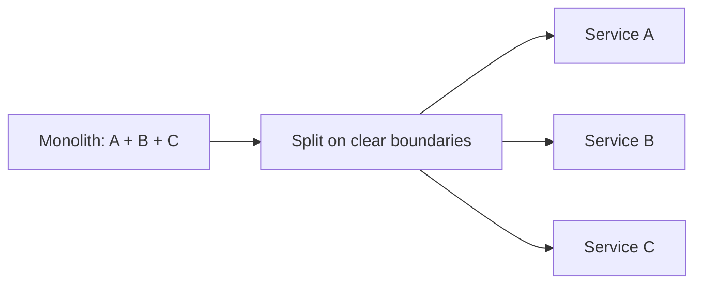

# 28. Microservices vs monolith?

> Part A: Fundamentals

**Answer:** Monolith: simple to build, deploy, test; scales as one unit. Microservices: independent scaling/deploys/tech, team autonomy; cost is network failures, distributed transactions, observability. Start modular monolith, split on clear boundaries.

---
[⬆ Back to index](../../README.md#-question-index)
