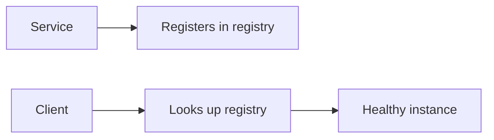

# 29. Service discovery?

> Part A: Fundamentals

**Answer:** Services register with a registry (Consul, etcd, Eureka, Kubernetes DNS) and clients find healthy instances. Client-side discovery (client picks instance) vs server-side (LB/proxy does). Use heartbeats/TTL to drop dead nodes; service mesh (Envoy/Istio) adds sidecar routing.

---
[⬆ Back to index](../../README.md#-question-index)
