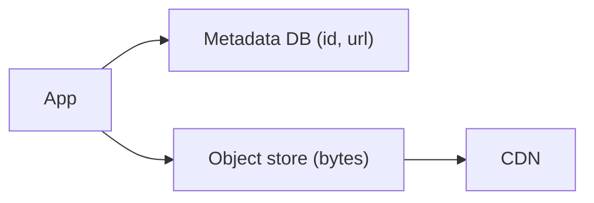

# 30. Blob/object storage vs file vs block storage?

> Part A: Fundamentals

**Answer:** Block: raw volumes for DBs/VMs (low latency). File: hierarchical shared FS (NFS/EFS). Object: flat namespace, HTTP API, huge scale, cheap, immutable objects (S3). Store media in object storage and metadata in a DB.

---

---
[⬆ Back to index](../../README.md#-question-index)
