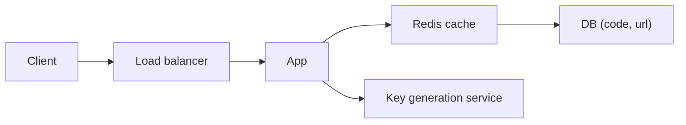

# 31. Design a URL shortener (TinyURL).

> Part B: Classic System Designs

**Answer:** Generate a 7-char base62 code (62^7 ≈ 3.5T) via counter + base62 (ranges per app server) or a key-generation service; store code->URL in a KV store/NoSQL. Redirect with HTTP 301/302; cache hot codes in Redis; read-heavy (100:1). Handle expiry, custom aliases, analytics asynchronously.

> 📘 **Want more?** Read the [deep dive: URL Shortener (TinyURL)](../deep-dives/01-url-shortener.md)

---
[⬆ Back to index](../../README.md#-question-index)
