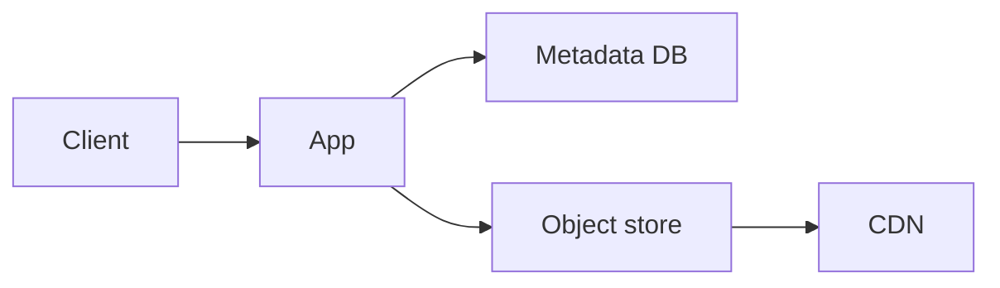

# 32. Design Pastebin.

> Part B: Classic System Designs

**Answer:** Store paste text in object storage, metadata (id, expiry, owner) in DB; id from key-generation service. CDN/caching for popular pastes; cleanup job for expired pastes; size limits and abuse detection.

---
[⬆ Back to index](../../README.md#-question-index)
