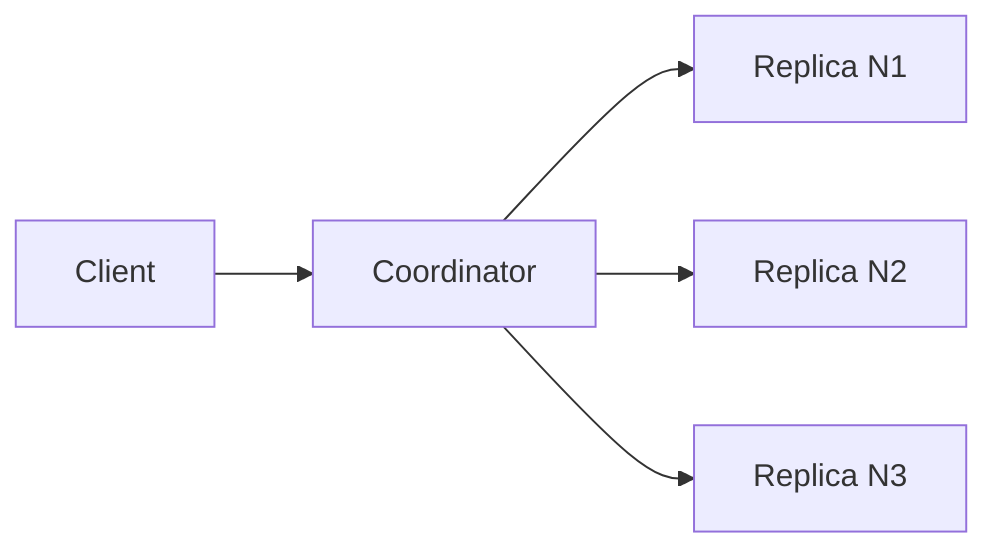

# 33. Design a distributed key-value store (Dynamo-style).

> Part B: Classic System Designs

**Answer:** Partition via consistent hashing, replicate to N nodes, quorum reads/writes (R+W>N), vector clocks or LWW for conflicts, hinted handoff, read repair, anti-entropy with Merkle trees, gossip for membership, LSM storage with WAL.

---
[⬆ Back to index](../../README.md#-question-index)
