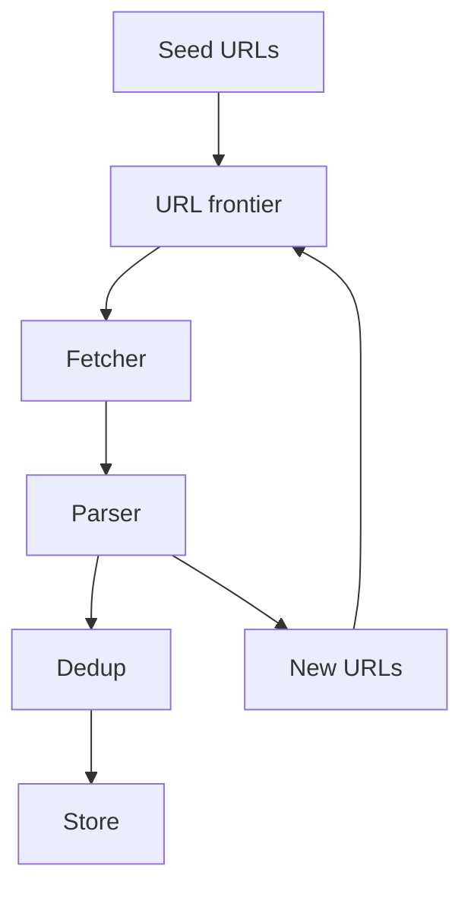

# 35. Design a web crawler.

> Part B: Classic System Designs

**Answer:** URL frontier (priority + politeness queues per host), fetchers, DNS cache, HTML parser, dedup (URL set via bloom filter, content hash/simhash), robots.txt, storage, link extraction feeding the frontier. Distribute by host hash; handle spider traps and recrawl scheduling.

---
[⬆ Back to index](../../README.md#-question-index)
