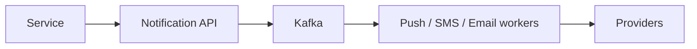

# 36. Design a notification system (push/SMS/email).

> Part B: Classic System Designs

**Answer:** API validates and enqueues; per-channel queues and workers call providers (APNs/FCM, Twilio, SES); user preferences, templates, rate limiting, dedup, retries with backoff, DLQ, delivery tracking and analytics.

> 📘 **Want more?** Read the [deep dive: Notification System](../deep-dives/05-notification-system.md)

---
[⬆ Back to index](../../README.md#-question-index)
