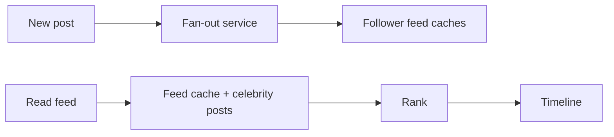

# 37. Design a news feed (Facebook/Twitter timeline).

> Part B: Classic System Designs

**Answer:** Fan-out on write (precompute feed in cache per follower; fast reads, heavy for celebrities) vs fan-out on read (compute on request). Hybrid: push for normal users, pull for celebrities. Rank with ML, store posts in DB, feed ids in Redis lists, media on CDN.

> 📘 **Want more?** Read the [deep dive: News Feed](../deep-dives/03-news-feed.md)

---
[⬆ Back to index](../../README.md#-question-index)
