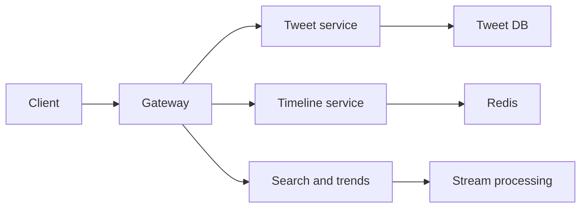

# 38. Design Twitter.

> Part B: Classic System Designs

**Answer:** Services: tweet, user graph, timeline, search, trends, notifications. Tweets in sharded store (Snowflake IDs), timelines via hybrid fan-out, search via inverted index (Earlybird/Elasticsearch), trends via streaming counts, media in object store + CDN.

---
[⬆ Back to index](../../README.md#-question-index)
