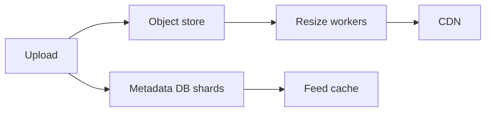

# 39. Design Instagram.

> Part B: Classic System Designs

**Answer:** Photo upload to object storage (multiple resolutions via async workers), metadata in sharded DB, follow graph, feed generation (hybrid), CDN for delivery, likes/comments counters via eventual consistency, explore/recommendation pipeline.

---
[⬆ Back to index](../../README.md#-question-index)
