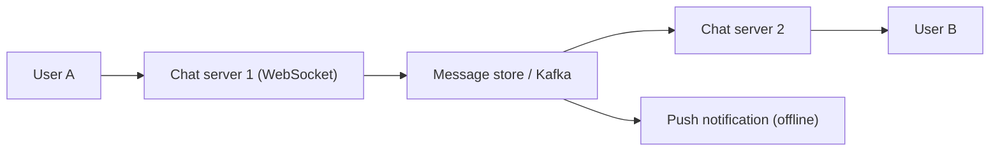

# 40. Design a chat system (WhatsApp/Messenger).

> Part B: Classic System Designs

**Answer:** Persistent WebSocket connections to chat servers; a session service maps user->server; messages go to message queue/store (per-chat partition key), delivered online via the recipient's server or stored for offline + push notification. Ack states (sent/delivered/read), per-chat ordering with sequence IDs, group fan-out, E2E encryption.

> 📘 **Want more?** Read the [deep dive: Chat System (WhatsApp / Messenger)](../deep-dives/04-chat-system.md)

---
[⬆ Back to index](../../README.md#-question-index)
