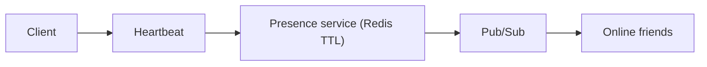

# 41. Design group chat and presence (online status).

> Part B: Classic System Designs

**Answer:** Group messages fan-out to members (small groups push, large via pull/channels). Presence via heartbeats stored in Redis with TTL; publish status changes only to friends who are online; avoid broadcasting every blip (debounce).

---
[⬆ Back to index](../../README.md#-question-index)
