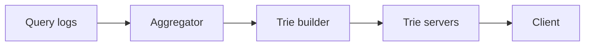

# 42. Design search autocomplete (typeahead).

> Part B: Classic System Designs

**Answer:** Trie (or prefix index) with top-K suggestions cached per node; built offline from query logs (aggregated by frequency/recency), served from memory/Redis; client debounce; shard by prefix; update via periodic rebuild or streaming.

---
[⬆ Back to index](../../README.md#-question-index)
