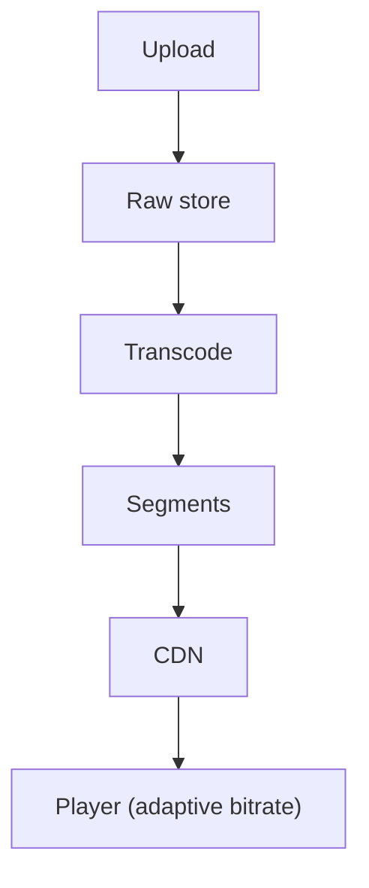

# 43. Design YouTube / Netflix (video streaming).

> Part B: Classic System Designs

**Answer:** Upload to object store, transcoding pipeline (DAG of workers) into multiple bitrates/codecs, chunked adaptive streaming (HLS/DASH), CDN/ISP caches (Open Connect), metadata DB, recommendations, view counts via streaming aggregation.

> 📘 **Want more?** Read the [deep dive: Video Streaming (YouTube / Netflix)](../deep-dives/06-video-streaming.md)

---
[⬆ Back to index](../../README.md#-question-index)
