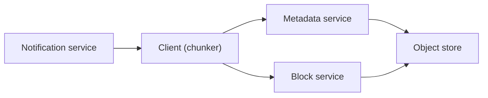

# 44. Design Google Drive / Dropbox.

> Part B: Classic System Designs

**Answer:** Split files into chunks (4MB), hash each, upload only changed chunks (delta sync), dedup via content-hash, metadata service in SQL, blobs in object store, notification service (long poll/WS) for sync, conflict resolution (versioning), sharing ACLs.

> 📘 **Want more?** Read the [deep dive: File Storage and Sync (Google Drive / Dropbox)](../deep-dives/08-file-storage-sync.md)

---
[⬆ Back to index](../../README.md#-question-index)
