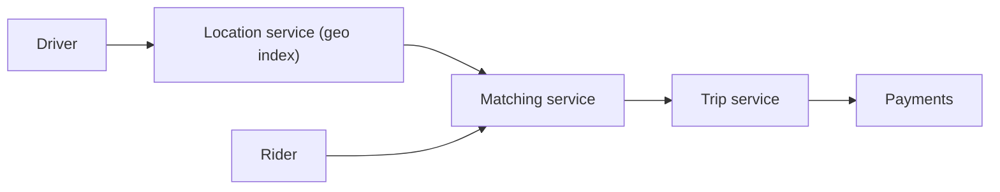

# 45. Design Uber / ride hailing.

> Part B: Classic System Designs

**Answer:** Drivers send location every ~4s to a location service (geohash/quadtree/S2 index in Redis); rider request -> matching service finds nearby drivers, ranks by ETA, offers with timeout; trip service state machine; pricing (surge); maps/ETA; payments. Use WebSockets for live updates.

> 📘 **Want more?** Read the [deep dive: Ride Hailing (Uber)](../deep-dives/07-ride-hailing.md)

---
[⬆ Back to index](../../README.md#-question-index)
