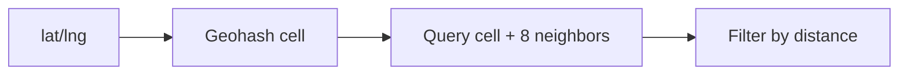

# 46. Design a proximity service (Yelp / nearby friends).

> Part B: Classic System Designs

**Answer:** Geospatial indexes: geohash (prefix = nearby, check neighbors), quadtree (adaptive), S2/H3 cells. Static businesses: DB with geohash index + cache; moving entities: in-memory grid/Redis GEO. Search the cell and its 8 neighbors, then filter by distance.

---
[⬆ Back to index](../../README.md#-question-index)
