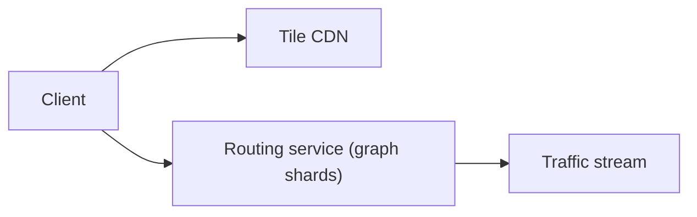

# 47. Design Google Maps.

> Part B: Classic System Designs

**Answer:** Map tiles (pre-rendered vector/raster pyramid by zoom) on CDN; road network graph partitioned hierarchically; routing with A*/Contraction Hierarchies; live traffic from probe data via streaming; ETA service; geocoding index.

---
[⬆ Back to index](../../README.md#-question-index)
