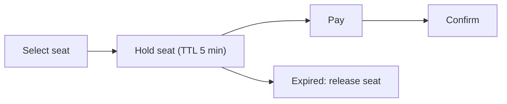

# 48. Design a ticket booking system (Ticketmaster).

> Part B: Classic System Designs

**Answer:** Prevent double-booking: seat hold with TTL (Redis lock or DB row version/optimistic lock), then payment, then confirm. Use virtual waiting room/queue for flash demand, inventory in strongly consistent DB, idempotent payments.

> 📘 **Want more?** Read the [deep dive: Ticket Booking (Ticketmaster)](../deep-dives/09-ticket-booking.md)

---
[⬆ Back to index](../../README.md#-question-index)
