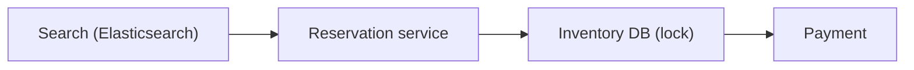

# 49. Design a hotel reservation system (Airbnb/Booking).

> Part B: Classic System Designs

**Answer:** Inventory per room-type per date with unique constraint/optimistic locking to avoid overbooking; search via Elasticsearch with availability filter; reservation state machine; idempotency keys; payments via saga; reviews and ranking separate services.

---
[⬆ Back to index](../../README.md#-question-index)
