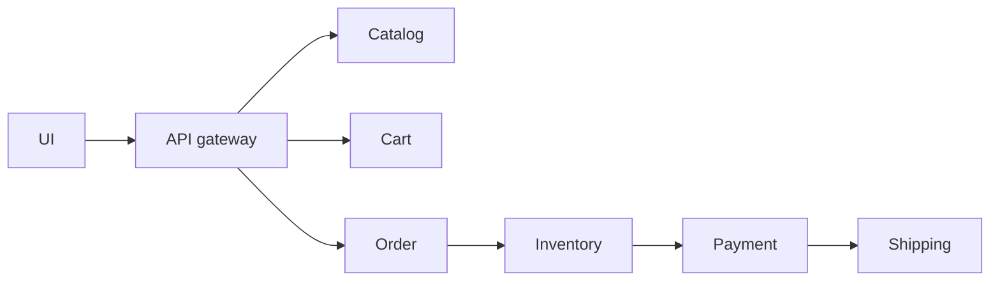

# 50. Design an e-commerce platform (Amazon).

> Part B: Classic System Designs

**Answer:** Services: catalog (search), cart, inventory, orders, payments, shipping, recommendations. Order flow uses saga/outbox events; inventory reserved then committed; cart in Redis/DynamoDB; product pages heavily cached; search via inverted index.

---
[⬆ Back to index](../../README.md#-question-index)
