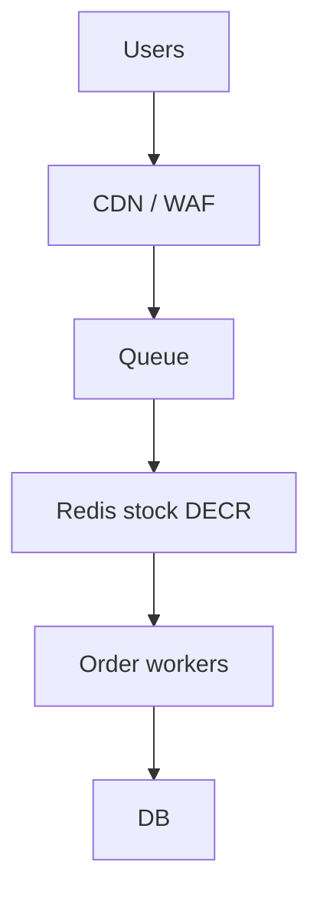

# 51. Design a flash sale system.

> Part B: Classic System Designs

**Answer:** Absorb spikes: CDN static, rate limit/queue at edge, pre-load stock in Redis with atomic DECR, async order creation via queue, DB write on confirmation only, overselling prevention, idempotent orders, degrade non-critical features.

---
[⬆ Back to index](../../README.md#-question-index)
