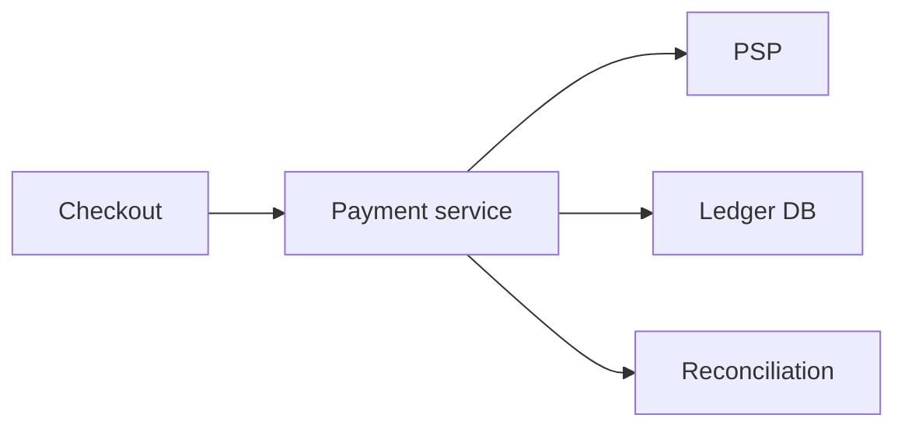

# 52. Design a payment system.

> Part B: Classic System Designs

**Answer:** Payment service talks to PSPs; idempotency keys; double-entry ledger; state machine (created, authorized, captured, refunded); reconciliation jobs against PSP reports; retries with dedup; PCI scope isolation (tokenization); async webhooks with signature verification.

> 📘 **Want more?** Read the [deep dive: Payment System](../deep-dives/10-payment-system.md)

---
[⬆ Back to index](../../README.md#-question-index)
