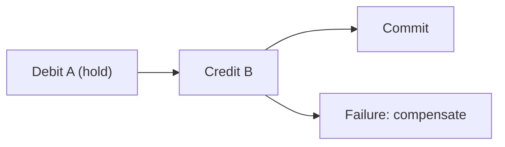

# 53. Design a digital wallet.

> Part B: Classic System Designs

**Answer:** Balance changes via double-entry ledger in ACID DB; transfers between shards via distributed transaction (2PC or saga with reservation) or event sourcing with replay; idempotent ops; audit log; fraud checks.

---
[⬆ Back to index](../../README.md#-question-index)
