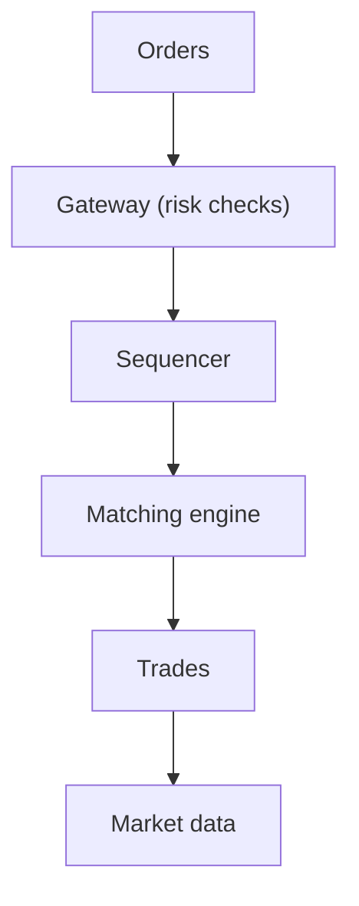

# 54. Design a stock exchange / order matching engine.

> Part B: Classic System Designs

**Answer:** Single-threaded deterministic matching per symbol (price-time priority) with in-memory order book, sequencer for total ordering, event-sourced journal replicated for recovery, market data publishers, risk checks at gateway, ultra-low latency networking.

---
[⬆ Back to index](../../README.md#-question-index)
