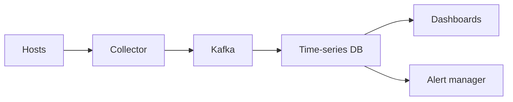

# 55. Design a metrics/monitoring system (Prometheus/Datadog).

> Part B: Classic System Designs

**Answer:** Agents push/pull metrics -> Kafka -> time-series DB (compression, downsampling, retention tiers); query engine; alert evaluator -> notification routing; cardinality control; dashboards.

---
[⬆ Back to index](../../README.md#-question-index)
